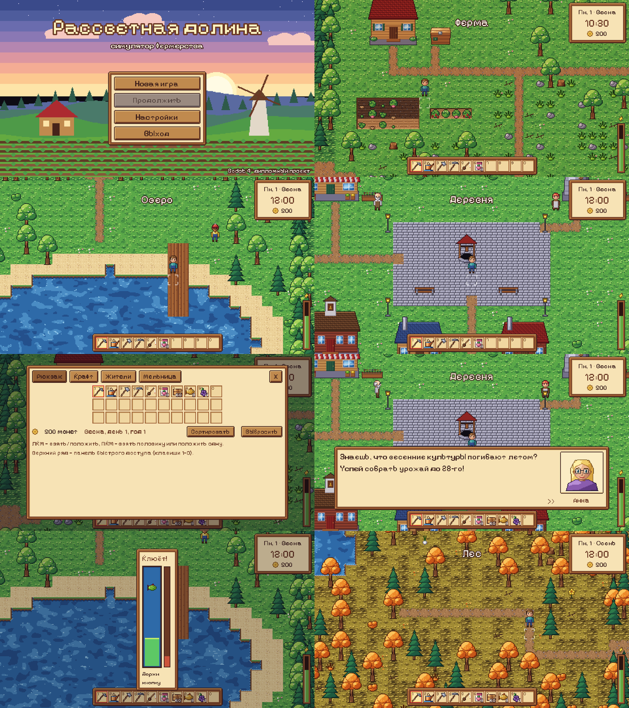

# Рассветная долина

Двумерный симулятор фермерства в стиле пиксель-арт на **Godot 4** (по ТЗ дипломной работы).
Герой получает в наследство заброшенную ферму, выращивает урожай, рыбачит, добывает руду в шахте,
дружит с жителями деревни и помогает восстановить старую мельницу.



---

## Как запустить на компьютере

### 1. Установить Godot
1. Скачай **Godot 4.3** или новее — обычную версию, **не .NET**: <https://godotengine.org/download>
2. **Windows:** распакуй zip — внутри файл `Godot_v4.x-stable_win64.exe`, установка не нужна.
   **macOS:** перетащи `Godot.app` в «Программы».
   **Linux:** распакуй и сделай файл исполняемым: `chmod +x Godot_v4*`.

### 2. Скачать игру
На странице репозитория: **Code → Download ZIP**, распакуй. Нужна папка `dawn-valley`.

### 3. Открыть и запустить
1. Запусти Godot. В менеджере проектов нажми **Import** (Импорт).
2. Выбери файл `dawn-valley/project.godot` → **Import & Edit**.
   При первом открытии Godot 5–20 секунд импортирует графику и звук — это нормально.
3. Нажми **F5** (или ▶ в правом верхнем углу). Откроется главное меню игры.

Запуск без редактора (после первого открытия проекта):
```
Godot_v4.3-stable_win64.exe --path путь\к\dawn-valley
```

### 4. Собрать отдельный .exe (по желанию)
1. В Godot: **Editor → Manage Export Templates → Download and Install** (один раз, ~1 ГБ).
2. **Project → Export → Add… → Windows Desktop** (или Linux).
3. **Export Project** → имя `DawnValley.exe`. Рядом появится `.pck` (или отметь *Embed PCK*, чтобы был один файл).

Системные требования: Windows 10+/Linux, 2 ГБ ОЗУ, видеокарта с OpenGL 3.3 (режим Compatibility).

---

## Управление

| Действие | Клавиша |
|---|---|
| Ходить | W A S D / стрелки |
| Использовать инструмент / предмет | ЛКМ / Пробел (удерживай — повтор) |
| Действие: говорить, собрать, открыть, дверь | ПКМ / E |
| Выбрать слот | 1–0 / колесо мыши / клик по панели |
| Рюкзак, крафт, жители, мельница | Tab / I |
| Пауза и настройки | Esc |

Мышью можно указывать клетку рядом с персонажем — рамка-курсор показывает, куда будет действие.

## Что есть в игре

- **Хабовый мир:** ферма (хаб) → деревня, лес, озеро, шахта на 10 уровней, дом героя.
- **Время:** 06:00–24:00, 10 игровых минут = 7 секунд; 4 сезона по 28 дней; день/ночь.
  В 24:00 герой засыпает сам и утром имеет только половину энергии.
- **Энергия 100:** вспашка −2, полив −1, рубка −3, кирка −3, заброс удочки −2. Еда восстанавливает.
- **Земледелие:** 9 культур по таблице ТЗ (редис, картофель, клубника / кукуруза, томат, арбуз /
  капуста, свёкла, тыква). Растёт только политое; при смене сезона чужие культуры погибают.
- **Инвентарь:** 30 ячеек, 10 — панель быстрого доступа; перетаскивание, деление стопки, сортировка.
- **Крафт:** сундук, забор, каменная плитка, разбрызгиватель (поливает 4 соседние грядки каждое утро),
  еда: ягодный перекус, грибной суп, уха, овощное рагу.
- **Экономика:** семена в лавке Тимофея (9:00–17:00), продажа через ящик отгрузки — деньги утром,
  отчёт «Итоги дня».
- **Рыбалка:** мини-игра — удерживай кнопку, чтобы зелёная зона держала рыбу. 6 видов рыбы по сезонам.
- **Шахта:** камни, медь, железо (с 4 ур.), золото (с 8 ур.), лестницы вниз, подъёмник, сокровище на 10 уровне.
- **Лес:** рубка деревьев (пни отрастают), сезонные дары леса каждый день.
- **Жители:** Тимофей, Марфа, Илья, Анна — расписания, диалоги из JSON, отношения 0–1000 (10 сердец),
  подарок раз в день: любимый +45, обычный +20, нелюбимый −20.
- **Мельница:** 4 набора (урожай, рыба, руда, древесина) — цель года. После неё игра продолжается.
- **Сохранение:** автоматически каждую ночь в `user://savegame.json`, «Продолжить» в главном меню.
  Windows: `%APPDATA%\Godot\app_userdata\Рассветная долина\`.
- **Звук:** музыка для каждого сезона и шахты, звуки действий и интерфейса; громкость в настройках.

## Структура проекта

```
project.godot            настройки: 480×270, целочисленное масштабирование, фильтр Nearest, Compatibility
scenes/                  main_menu, game, player, npc (+ tests/)
scripts/autoload/        Db, GameClock, Inventory, Economy, Game, SaveManager, Audio (глобальные объекты)
scripts/                 game.gd (сцена), location.gd (локация), maps.gd (карты), player.gd, npc.gd
scripts/ui/              HUD, диалоги, меню, лавка, ящик/сундук, мельница, рыбалка, пауза, итоги дня
data/                    items, crops, fish, recipes, bundles (JSON), npcs/*.json — диалоги жителей
shaders/water.gdshader   анимированная вода
assets/                  sprites/, audio/, fonts/
tools/                   генераторы графики и звука на Python
tests/                   автотесты
```

Взаимодействие систем — через сигналы: `GameClock.day_started`, `minute_passed`, `time_up`,
`Inventory.changed`, `Economy.money_changed`, `Game.notify` и др.

## Автотесты

Сцены в `tests/` запускаются в редакторе (открыть сцену → F6) или из консоли:
```
godot --headless --path dawn-valley res://tests/play_test.tscn    # план тестирования из ТЗ (табл. 8)
godot --headless --path dawn-valley res://tests/input_test.tscn   # ходьба, инструменты, двери, сон через ввод
```

## Перегенерация графики и звука

Нужен Python 3 и `pip install pillow numpy`:
```
cd dawn-valley/tools
python build.py     # все спрайты → assets/sprites, data/item_frames.json
python audio.py     # музыка и звуки → assets/audio
```
